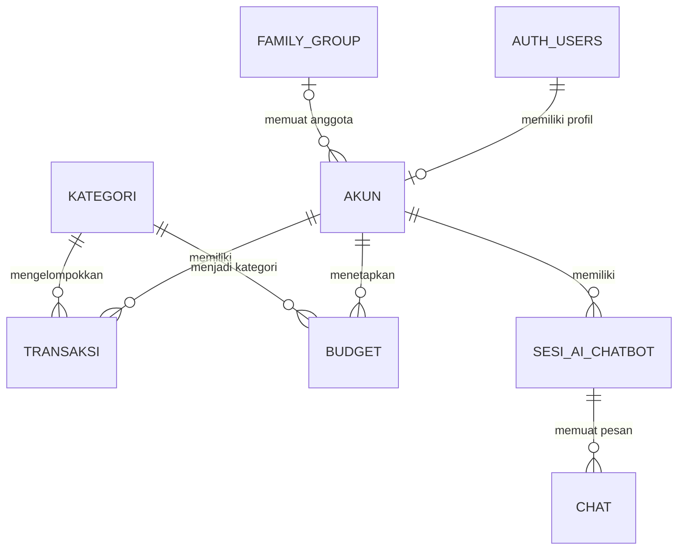
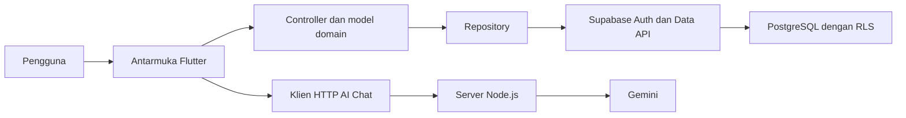

# BAB 3 — IMPLEMENTASI

Implementasi SIFinance menerjemahkan rancangan aplikasi pengelolaan keuangan pribadi dan keluarga ke dalam aplikasi Flutter. Beranda menyediakan navigasi ke Dashboard Personal, Budget, AI Chat, dan formulir pencatatan manual. Pengelolaan keluarga dan penyimpanan percakapan telah memiliki fondasi skema basis data.

## 3.1 Lingkungan Pengembangan

Aplikasi dikembangkan dengan Flutter dan Dart. Berkas `pubspec.yaml` menetapkan Flutter minimal 3.47.0 dan rentang Dart `^3.13.0`. Satu basis kode Flutter memuat tampilan, navigasi, logika fitur, serta klien untuk Supabase dan layanan AI. Repositori menyediakan konfigurasi untuk Android, iOS, web, dan desktop. Pustaka `material_ui` digunakan untuk komponen antarmuka, `fl_chart` untuk visualisasi pengeluaran, dan `intl` untuk format tanggal dan rupiah dengan lokal Indonesia. Font Poppins, ikon, dan ilustrasi tersedia di direktori `assets/`.

Backend pengolahan data terdiri dari Supabase untuk autentikasi dan data keuangan, serta server Node.js untuk perantara komunikasi dengan Gemini. Untuk pengembangan lokal, Supabase dijalankan melalui Supabase CLI dan Docker. Migrasi membentuk skema dan kebijakan akses, sedangkan data seed menyediakan akun dan data contoh. Server AI dapat dijalankan secara terpisah. Flutter memakai respons demo ketika `API_BASE_URL` kosong, sehingga antarmuka percakapan dapat diuji tanpa koneksi ke Gemini.

## 3.2 Repositori Kode (GitHub)

Kode sumber disimpan di repositori GitHub SIFinance. Uraian implementasi pada bab ini mengacu pada revisi `20c4c53` beserta perubahan integrasi Beranda, navigasi, dan autentikasi yang didokumentasikan pada bab ini. [Repositori SIFinance](https://github.com/b4r1e/SIfinance)

| Lokasi | Isi |
| --- | --- |
| `lib/main.dart` dan `lib/app.dart` | Inisialisasi aplikasi, tema, dan rute awal. |
| `lib/core/` | Konfigurasi dan tipe data Supabase serta navigasi utama. |
| `lib/features/` | Implementasi autentikasi, onboarding, beranda, dashboard, anggaran, pencatatan manual, dan AI Chat. |
| `supabase/` | Konfigurasi lingkungan lokal, migrasi PostgreSQL, seed, dan pengujian kebijakan akses. |
| `server/` | Endpoint AI Chat, integrasi Gemini, konteks aplikasi, dan tes backend. |
| `assets/` | Font, ikon, dan ilustrasi. |
| `test/` | Pengujian unit, widget, dan integrasi Supabase lokal. |

## 3.3 Backend as a Service (BaaS)

### 3.3.1 Supabase

Supabase menyediakan tiga fungsi utama bagi SIFinance. Supabase Auth mengelola akun dan sesi berbasis email serta kata sandi. PostgreSQL menyimpan profil, kategori, transaksi, anggaran, grup keluarga, dan percakapan. Data API digunakan oleh repository Flutter untuk membaca dan menulis data. Row Level Security (RLS) membatasi akses baris berdasarkan identitas pengguna yang diperoleh dari sesi.

CDR v1.1 mendeskripsikan Laravel, Eloquent, dan MVC sebagai teknologi rancangan awal. Implementasi pada repositori menggunakan Flutter dengan lapisan presentasi, domain, dan akses data, serta Supabase sebagai BaaS. Relasi inti dari model domain CDR tetap dipakai pada skema PostgreSQL. Pemrosesan AI ditempatkan di server Node.js tersendiri.

### 3.3.2 Konfigurasi Awal Supabase

Aplikasi membaca `SUPABASE_URL` dan `SUPABASE_PUBLISHABLE_KEY` melalui konfigurasi build Flutter. Berkas `config/supabase.example.json` merupakan templat konfigurasi. `main.dart` menginisialisasi klien ketika konfigurasi tersedia dan aplikasi berjalan di luar mode `CHAT_ONLY`. Klien kemudian diteruskan ke alur autentikasi dan repository fitur yang memerlukannya.

Skema dibangun melalui migrasi di `supabase/migrations/`. Migrasi awal membuat profil, kategori, transaksi, dan anggaran. Migrasi berikutnya mengisi kategori referensi serta menyesuaikan nama tabel dan relasi dengan CDR. `supabase/seed.sql` menyediakan data pengembangan lokal, termasuk dua akun demo dengan transaksi berbeda untuk memeriksa pemisahan data per akun.

### 3.3.3 Implementasi Skema Basis Data

| Tabel | Peran dan relasi |
| --- | --- |
| `akun` | Profil dengan ID UUID yang merujuk ke `auth.users`. Menyimpan nama, referensi grup opsional, dan tiga preferensi privasi keluarga. |
| `kategori` | Referensi kategori transaksi dan anggaran. ID bertipe `bigint` dan metadata mencakup nama, grup, status aktif, warna, dan ikon. |
| `transaksi` | Mencatat pemasukan atau pengeluaran. `user_id` merujuk ke akun dan `category_id` ke kategori. Nominal disimpan sebagai `numeric(14,2)` dan tanggal sebagai `date`. Kolom lain memuat keterangan, lokasi, akun pembayaran, dan penanda transaksi pribadi. |
| `budget` | Menyimpan batas anggaran per akun dan kategori, dengan nominal `numeric(14,2)`, tipe periode, serta tanggal awal dan akhir. |
| `family_group` | Menyimpan ID grup, kode QR, dan tautan undangan. Satu grup dapat dirujuk oleh beberapa akun. |
| `sesi_ai_chatbot` | Menyimpan ID sesi, ID akun pemilik, dan waktu mulai. Satu akun dapat memiliki beberapa sesi. |
| `chat` | Menyimpan pesan, waktu kirim, pengirim, dan referensi lampiran opsional. Setiap pesan terkait dengan satu sesi percakapan. |

*Gambar 3.1. Relasi tabel hasil migrasi SIFinance. `AUTH_USERS` merepresentasikan tabel `auth.users` yang dikelola Supabase Auth.*

### 3.3.4 Implementasi API, Kueri, dan Kontrol Akses

| Operasi | Implementasi |
| --- | --- |
| Autentikasi | `AuthRepository` memanggil `signUp`, `signInWithPassword`, dan `signOut`, serta memantau perubahan sesi. Trigger PostgreSQL membuat baris `akun` dari pengguna Auth baru. |
| Dashboard Personal | Repository membaca pengeluaran berdasarkan `user_id`, rentang tanggal, dan tipe `expense`. Kueri menyertakan kategori dan mengambil transaksi bertahap hingga 500 baris per halaman dengan kursor ID. |
| Pencatatan manual | Repository membaca kategori aktif dan memasukkan transaksi ke tabel `transaksi` dengan ID pemilik. |
| Budget | Repository membaca anggaran beserta kategori, mengambil pengeluaran akun untuk periode yang relevan, serta menyimpan anggaran baru atau perubahan anggaran. |
| AI Chat | Klien HTTP mengirim permintaan ke `POST /api/chat` pada server Node.js. Endpoint tersebut berkomunikasi dengan Gemini menggunakan kunci dari variabel lingkungan server. |

Kebijakan RLS membatasi profil, transaksi, dan anggaran pada pemilik, sementara kategori dapat dibaca oleh pengguna terautentikasi. Baris grup hanya dapat dibaca oleh anggota grup tersebut, dan klien terautentikasi tidak dapat menetapkan keanggotaan sendiri melalui kolom `family_group_id`. Sesi dan pesan dibatasi berdasarkan pemilik sesi. Ketiga preferensi privasi keluarga telah tersedia sebagai kolom profil, sementara aturan akses transaksi pada revisi ini masih membatasi semua transaksi pada pemiliknya.

Migrasi menyediakan `total_terpakai` sebagai field terhitung pada Data API. Fungsi tersebut menjumlahkan pengeluaran pemilik untuk kategori dan tanggal yang tersimpan pada baris anggaran. Layar Budget menghitung pemakaian dari kueri transaksi berdasarkan bulan kalender berjalan. Perbedaan sumber rentang tanggal ini penting untuk anggaran bulanan berulang, karena tanggal awal dan akhir yang tersimpan berasal dari waktu anggaran dibuat atau diubah.

## 3.4 Strategi Implementasi dan Struktur Kode

Kode Flutter dikelompokkan menurut fitur. Pada fitur seperti Dashboard, Budget, dan pencatatan manual, lapisan `presentation` memuat halaman, widget, dan controller. Lapisan `domain` memuat model serta aturan seperti perhitungan periode dan ringkasan pengeluaran. Lapisan `data` memuat kontrak repository dan implementasi akses Supabase. Tipe baris hasil generasi di `lib/core/supabase/generated/database.g.dart` membantu memetakan data basis data ke model Dart. Kontrak repository memungkinkan pengujian formulir dan perhitungan menggunakan data uji.

*Gambar 3.2. Alur akses data keuangan dan pemrosesan AI Chat.*

### 3.4.1 Pendaftaran, Masuk, dan Keluar Akun

Alur awal menampilkan splash dan onboarding. Ketika pengguna melanjutkan dengan konfigurasi Supabase aktif, `AuthPage` membaca sesi dan berlangganan perubahan status autentikasi. Pengguna tanpa sesi dapat masuk atau mendaftar, sedangkan pengguna dengan sesi membuka Beranda. `AppShell` meneruskan ID akun kepada repository Dashboard, Budget, dan pencatatan manual. Aksi keluar mengakhiri sesi lokal dan mengembalikan pengguna ke formulir masuk. Mode tanpa konfigurasi membuka Beranda yang sama dengan penyimpanan demo dalam memori.

Pendaftaran memvalidasi nama, email, kata sandi, dan konfirmasi kata sandi. Nama dikirim sebagai metadata saat membuat akun dan disalin ke profil oleh trigger. Formulir masuk menggunakan autentikasi email dan kata sandi. Pesan dari Supabase, misalnya kredensial salah atau email sudah terdaftar, dipetakan ke pesan berbahasa Indonesia. Konfirmasi email dinonaktifkan pada konfigurasi Supabase lokal. Ketika proyek memerlukan konfirmasi email, formulir meminta pengguna memeriksa email sebelum masuk. Tombol Google pada mode demo menyimulasikan navigasi. OAuth Google dan pemulihan kata sandi dengan kode belum terintegrasi.

### 3.4.2 Beranda dan Dashboard Personal

`HomePage` memakai navigasi bawah yang sama untuk mode demo dan mode Supabase. Pengguna dapat membuka Dashboard Personal, Budget, pencatatan manual melalui **Catat**, dan AI Chat. Menu **Transaksi** menampilkan pemberitahuan hingga riwayat tersedia. Pada mode Supabase, Beranda menyediakan akses cepat ke Dashboard dan Budget. Ringkasan saldo, pemasukan, dan transaksi terakhir pada rancangan Beranda masih berupa contoh yang ditampilkan di mode demo.

Dashboard menampilkan total pengeluaran, grafik batang dan rata-rata enam bulan kalender terakhir, serta grafik dan rincian pengeluaran per kategori. Pengguna dapat memilih Bulan ini, 3 bulan, 6 bulan, Tahun ini, atau Semua waktu. Filter mengubah total dan distribusi kategori. Grafik batang mempertahankan rentang enam bulan kalender, termasuk bulan berjalan dan bulan tanpa pengeluaran. Rata-rata dihitung dari total enam bulan dibagi enam. Tampilan menyediakan keadaan memuat, data kosong, dan kegagalan pengambilan data.

### 3.4.3 Pencatatan Transaksi Manual

`ManualLoggingPage` menyediakan pilihan jenis transaksi, tanggal, kategori dengan pencarian, nominal, akun pembayaran, lokasi, keterangan, dan penanda transaksi pribadi. Controller menyaring kategori menurut jenis pemasukan atau pengeluaran dan mewajibkan nominal positif serta kategori yang sesuai. `SupabaseManualLoggingRepository` meneruskan transaksi yang valid ke tabel `transaksi`. Formulir mempertahankan isian ketika penyimpanan gagal.

Aksi **Selesai** menyimpan transaksi dan menutup formulir saat halaman dapat ditutup. **Tambah Lagi** menyimpan transaksi, mempertahankan jenis, tanggal, dan akun pembayaran, lalu mengosongkan isian lain. Modul telah memiliki pengujian unit dan widget. Menu **Catat** membuka formulir dari navigasi Beranda. Setelah penyimpanan berhasil, Dashboard dan Budget yang sudah terbuka memuat ulang data. Filter Dashboard yang sedang dipilih dipertahankan. Riwayat transaksi khusus dan pencatatan melalui perintah suara masih berada pada tahap rancangan.

### 3.4.4 Pengelolaan Budget

Tab Budget menyediakan daftar anggaran per kategori beserta batas nominal, pemakaian, sisa, dan indikator progres. Pengguna dapat menambah anggaran atau menyunting anggaran yang ada. Controller memuat ulang daftar setelah perubahan berhasil disimpan. Pilihan periode yang tersedia pada antarmuka saat ini adalah **Setiap Bulan**.

Pemakaian anggaran dihitung dari jumlah transaksi pengeluaran pada kategori yang sama, dari tanggal pertama hingga terakhir bulan berjalan. Sisa anggaran merupakan batas dikurangi pemakaian. Bilah progres berhenti pada batas visual 100 persen, sementara angka persentase masih dapat melebihi 100 persen. Kartu anggaran membedakan kondisi ketika batas sudah terlampaui. Peringatan otomatis ketika pengeluaran baru mendekati batas belum tersedia.

### 3.4.5 AI Chat

Halaman AI Chat menyediakan pertanyaan cepat, pengiriman pesan, lampiran gambar dari kamera atau berkas sesuai dukungan platform, pratinjau gambar, pengiriman ulang saat gagal, dan reset percakapan. Lampiran yang didukung adalah JPEG, PNG, dan WebP hingga 4 MB. Klien mengirim pesan, riwayat teks terbaru, dan gambar pada permintaan terkait. Gambar perlu dilampirkan kembali jika ingin dianalisis pada pertanyaan berikutnya.

Backend memvalidasi payload dan menjalankan pemeriksaan topik sebelum meminta Gemini menghasilkan jawaban. Jawaban diperiksa ulang sebelum diteruskan ke Flutter. Lingkup yang diizinkan mencakup konsultasi keuangan dan bantuan penggunaan SIFinance. Percakapan yang lolos melibatkan tiga panggilan model. Saat `API_BASE_URL` kosong, klien memakai layanan demo dengan jawaban contoh.

Jawaban menggunakan informasi yang dimasukkan pengguna dan konteks produk dari server. Backend belum membaca transaksi atau anggaran akun pengguna. Percakapan disimpan dalam state halaman selama halaman masih aktif, termasuk ketika pengguna berpindah tab dalam shell yang sama. Tabel `sesi_ai_chatbot` dan `chat` sudah tersedia, sementara penyimpanan riwayat dan lampiran ke Supabase belum terhubung.

### 3.4.6 Keterlacakan terhadap CDR v1.1

| Kebutuhan CDR | Capaian pada revisi yang ditelaah |
| --- | --- |
| FR-01–FR-04 · Akun | Pendaftaran, masuk dengan email dan kata sandi, serta keluar tersedia. OAuth Google dan pemulihan kata sandi belum terintegrasi. |
| FR-05–FR-07 · Beranda dan Dashboard | Dashboard Personal menampilkan ringkasan pengeluaran dan filter. Ringkasan keuangan berbasis data akun pada Beranda serta ajakan membuat atau bergabung ke grup keluarga belum tersedia pada alur utama. |
| FR-08–FR-12 · Pencatatan dan riwayat | Pencatatan manual tersedia melalui menu Catat dan memuat ulang Dashboard serta Budget setelah penyimpanan. AI Voice, layar riwayat dan filternya, serta saldo Beranda masih dalam rancangan. |
| FR-13–FR-16 · Budget | Daftar, perhitungan, penambahan dan penyuntingan anggaran bulanan tersedia. Peringatan otomatis mendekati batas masih direncanakan. |
| FR-17–FR-19 · AI Chatbot | Chat, pertanyaan cepat, dan pengiriman gambar tersedia. Konteks data akun dan penyimpanan sesi serta lampiran belum terintegrasi. |
| FR-20–FR-26 · Family Group | Tabel, relasi keanggotaan, kolom privasi, dan kebijakan akses dasar tersedia. Alur undangan, bergabung, keluar, pengaturan privasi melalui antarmuka, dan Dashboard Keluarga belum terhubung ke aplikasi utama. |

### 3.4.7 Verifikasi Implementasi

Pengujian Flutter di `test/` mencakup splash dan onboarding, validasi formulir akun, agregasi dan filter Dashboard, pencatatan manual, serta perilaku AI Chat. Pengujian integrasi di `test/supabase_integration_test.dart` memerlukan Supabase lokal dan opsi `RUN_SUPABASE_INTEGRATION`. Skenario isolasi data antar-akun juga tersedia pada tes SQL di `supabase/tests/`.

Pengujian regresi Beranda mencakup navigasi ke fitur, penambahan dan penyuntingan anggaran, pembaruan Dashboard dan Budget setelah transaksi, serta perpindahan dari pendaftaran ke Beranda berdasarkan simulasi sesi. Dua skenario integrasi yang membutuhkan Supabase lokal dilewati karena layanan lokal tidak aktif. Dua belas tes backend Node.js lulus dengan respons model simulasi.

## Sumber Bab

- *Kelompok05_Champify.pdf*, Bab 3, halaman PDF 21–38, sebagai acuan susunan pembahasan implementasi.
- *Software Critical Design Review Document for SIFinance*, versi 1.1, Bagian 1.3–5, sebagai acuan kebutuhan fungsional, model domain, dan alur penggunaan.
- Repositori SIFinance revisi `20c4c53` beserta perubahan integrasi Beranda, terutama `lib/`, `supabase/`, `server/`, dan `test/`, sebagai sumber status implementasi.
